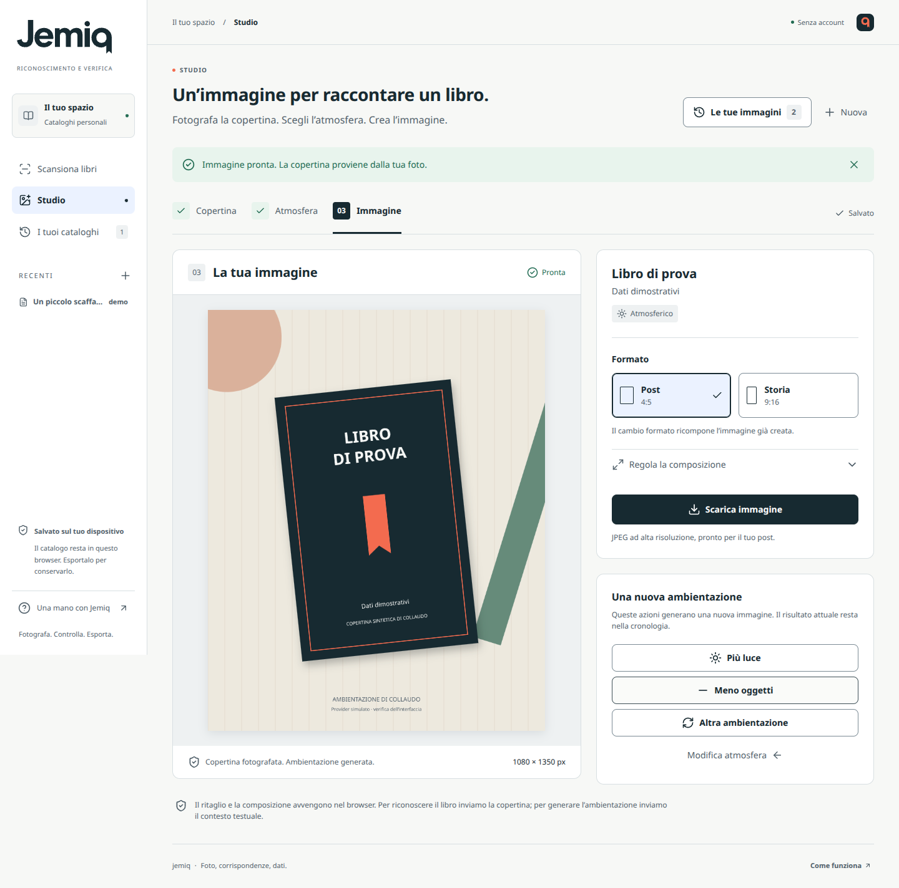

# Jemiq

**Fotografa i libri. Controlla il catalogo. Crea un’immagine per la tua lettura.**

Web app in italiano con due percorsi: **Catalogo** trasforma una foto di scaffali o tavoli di libri in un elenco verificabile; **Studio** compone la copertina fotografata di un singolo libro con un’ambientazione per una recensione o un post. Progettata per uso personale o per un piccolo gruppo di lavoro in libreria, su una singola istanza del server.

## Stato del progetto

Il repository originale, verificato il 10 ottobre 2026, conteneva soltanto il README di Google AI Studio e un unico commit su `main`. Questa è una nuova implementazione del flusso richiesto; non è stato possibile correggere sorgenti preesistenti perché non erano presenti.

I flussi software sono implementati e coperti da test automatici. **L’accuratezza del riconoscimento e la qualità delle ambientazioni AI su libri reali non sono ancora misurate**: occorrono credenziali operative e un campione controllato. La demo del catalogo è esplicita e marcata anche nei file esportati; non sostituisce mai una chiamata fallita. Studio può proporre un’atmosfera semplice dichiarata quando mancano dati o un servizio utilizzabile, ma non mostra immagini simulate come generazioni riuscite.

## Funzioni

### Catalogo

- Scatto tramite fotocamera del telefono o caricamento di una foto.
- Anteprima, rotazione e ricodifica locale in JPEG con lato lungo massimo 3200 px.
- Una chiamata Gemini per leggere le informazioni visibili, senza inventare i dati mancanti.
- Ricerca delle singole edizioni in Google Books e, quando necessario, Open Library.
- Risultati progressivi, annullamento, errori espliciti e conservazione delle righe già ricevute.
- Revisione dell’edizione, ricerca manuale, modifica dei dati e quantità esplicita.
- Segnalazione di possibili duplicati, senza accorparli né incrementare la quantità.
- Cronologia in IndexedDB, senza account e senza sincronizzazione fra dispositivi.
- Excel `.xlsx` e CSV con ISBN, titolo, autore, editore, pubblicazione, lingua, pagine, quantità, stato, fonte e note.

### Studio

- Un percorso per un solo libro, avviabile da **Studio** o dalla scheda di un libro nel catalogo.
- Foto della copertina e ritaglio con quattro angoli per correggere la prospettiva nel browser.
- Identificazione del libro e proposta modificabile con tre stili: **Atmosferico**, **Essenziale**, **Cinematografico**.
- Contesto da descrizione e categorie della scheda bibliografica, con fonti, mood personale e massimo tre elementi decorativi.
- Regola iniziale senza spoiler e separazione fra riferimenti al catalogo, indicazioni del lettore e scelte di stile. La proposta resta da controllare prima della generazione.
- Una chiamata per creare lo sfondo; copertina originale composta localmente e download JPEG **1080 × 1350 px** per il post o **1080 × 1920 px** per la storia. Il cambio formato riutilizza lo stesso sfondo, senza un’altra chiamata AI.
- Fino a 20 progetti in IndexedDB, separati dai cataloghi; recupero delle richieste senza reinviare automaticamente una generazione.

La copertina non viene inviata al generatore dello sfondo: ritaglio e composizione usano la foto nel browser. Il ritaglio intermedio è PNG; raddrizzamento, ridimensionamento e JPEG finale ricampionano i pixel, senza ridisegnare testo o grafica del libro. Non vengono ricostruite parti nascoste. [Uso, architettura e limiti di Studio](docs/STUDIO.md).

## Identità visiva

Catalogo e Studio applicano il brand book Jemiq 1.0 fornito dal proprietario: logo dai tracciati originali, colore principale `#172A31`, accento `#F36B4F` e font **Noto Sans** distribuito dal server dell’app, senza richieste a Google Fonts. I [token originali JSON](docs/brand/design-tokens.json) e le [variabili CSS](src/design-tokens.css) definiscono colori, tipografia, spaziature, focus e dimensioni dei controlli. La [licenza OFL dei font](public/fonts/OFL.txt) è inclusa nel repository.

## La regola sugli ISBN

Un titolo riconosciuto non identifica automaticamente la sua edizione. Jemiq non prende il primo ISBN di una ricerca e non lo presenta come verificato.

| Stato | Significato | ISBN nell’export |
| --- | --- | --- |
| ISBN riscontrato | Codice letto nella foto, checksum valido, presente nel catalogo e coerente con gli altri dati osservati | Compilato |
| Confermato da te | Edizione scelta o dati confermati esplicitamente dall’utente | Compilato se presente e valido |
| Da verificare | Esistono edizioni candidate, ma la foto non prova quale sia quella corretta | Vuoto; proposta separata |
| Da completare | Dati poco leggibili, libro fuori catalogo o cataloghi indisponibili | Vuoto |

Anche “ISBN riscontrato” è un riscontro software, non una garanzia assoluta: il modello può leggere male una cifra e i cataloghi possono contenere errori. Per gli ordini controllare la copia fisica. Una copertina simile non è prova dell’edizione.

Titolo e autori leggibili devono trovare riscontro nella scheda. Contraddizioni su editore o lingua, oppure un ISBN associato esplicitamente a un ebook, richiedono revisione. I dati di un’edizione candidata non vengono copiati nel record osservato prima del riscontro o della conferma dell’utente; gli ISBN aggregati di un’opera Open Library non identificano una singola edizione.

Gli ISBN-10 sono verificati e convertiti a ISBN-13. XLSX salva l’ISBN come testo. Il CSV usa UTF-8 con BOM, separatore `;`, quoting e neutralizzazione delle formule; Excel può comunque scegliere una visualizzazione numerica in importazione, quindi XLSX è preferibile.

## Avvio locale

Usare Node.js **24**, la versione verificata e configurata anche su Render.

```bash
npm ci
cp .env.example .env
npm run dev
```

Apri `http://localhost:3000`. Inserisci `GEMINI_API_KEY` nel file `.env` per configurare riconoscimento e proposta testuale; la stessa chiave viene usata anche per le immagini Studio, salvo una chiave dedicata. Senza chiavi restano disponibili demo, inserimento manuale, cronologia, esportazione, ritaglio Studio e proposte semplici dichiarate; le foto non vengono analizzate e gli sfondi AI non vengono generati.

“Scatta una foto” dipende dal supporto del browser e su computer può aprire il selettore di file. È sempre disponibile “Carica foto”. HEIC/HEIF funziona solo nei browser che lo decodificano; altrimenti viene richiesto JPEG, PNG o WebP.

## Configurazione

Le chiavi restano sul server. **Non usare prefissi `VITE_` per i segreti e non inserirli nel codice o in GitHub.**

| Variabile | Uso |
| --- | --- |
| `GEMINI_API_KEY` | Chiave server per riconoscimento e proposta Studio; usata anche per gli sfondi se manca la chiave dedicata |
| `GEMINI_MODEL` | Modello per lettura delle foto e proposta testuale con JSON strutturato; predefinito `gemini-3.8-flash` |
| `GEMINI_IMAGE_API_KEY` | Facoltativa: chiave separata per la generazione delle immagini Studio |
| `GEMINI_IMAGE_MODEL` | Modello degli sfondi, predefinito `gemini-nano-banana-2.1` |
| `STUDIO_ENABLED` | `false` disabilita le nuove generazioni di sfondi; progetti locali e preparazione restano disponibili |
| `GOOGLE_BOOKS_API_KEY` | Chiave dedicata per identificare l’app e avere una quota Books; raccomandata per un servizio operativo |
| `JEMIQ_ACCESS_TOKEN` | Codice di accesso di almeno 16 caratteri, obbligatorio in produzione |
| `APP_ORIGIN` | Origine pubblica completa, per esempio `https://jemiq.example.com` |
| `PORT` | Porta del server, predefinita 3000 |
| `HOST` | `127.0.0.1` in locale; `0.0.0.0` per un container |
| `TRUST_PROXY` | Numero esatto di proxy fidati davanti all’app; 0 predefinito |

Il codice di accesso protegge l’uso del servizio a pagamento, si inserisce per sessione e non è la chiave Gemini. È una protezione per un piccolo gruppo, non un sistema di account. I cataloghi restano nel browser di ogni persona.

Google Books può limitare le chiamate senza chiave: in una verifica reale il 10 ottobre 2026 ha risposto 429 e il fallback Open Library ha risolto l’ISBN di prova. Per la produzione configurare una chiave Books e verificare le quote del proprio progetto.

## Build e produzione

```bash
npm run build
npm start
```

`npm start` imposta esplicitamente la produzione e serve frontend e API dallo stesso processo. Occorre un servizio Node o un container con HTTPS. **GitHub Pages da solo non è sufficiente**, perché il riconoscimento richiede un server che custodisca la chiave.

```bash
docker build -t jemiq .
docker run --rm -p 3000:3000 --env-file .env -e HOST=0.0.0.0 jemiq
```

Configurare le chiavi, `JEMIQ_ACCESS_TOKEN` e `APP_ORIGIN` nelle impostazioni del servizio di hosting. `.env` è escluso dall’immagine e il container viene eseguito come utente non root. Il Dockerfile è fornito come percorso di distribuzione; la sua build va verificata nell’ambiente Docker di destinazione.

In produzione, se il codice di accesso manca o è troppo corto, le API restano chiuse. `/api/health` espone `recognitionReady`, `accessRequired` e `studioReady`, senza chiavi o dettagli dell’account. Questi campi indicano la configurazione applicativa: **non verificano validità delle credenziali, accesso ai modelli, quote o credito**.

### Avvio guidato su Render

**[Configura Jemiq su Render](https://render.com/deploy?repo=https%3A%2F%2Fgithub.com%2Femilioquattrini%2Fjemiq%2Ftree%2Fcodex%2Fjemiq-product)**

Il Blueprint [`render.yaml`](render.yaml) seleziona un servizio Node 24 a Francoforte sul piano Free per le prime prove. Chiede `GEMINI_API_KEY` e un `JEMIQ_ACCESS_TOKEN` di almeno 16 caratteri direttamente nel pannello Render; l'URL pubblico viene configurato automaticamente. Nessun segreto va aggiunto al file YAML.

Il link usa il ramo `codex/jemiq-product`. Gli aggiornamenti automatici sono disabilitati. Il piano Free si sospende dopo 15 minuti senza traffico e richiede circa un minuto per riattivarsi; è adatto al collaudo, mentre l'uso quotidiano richiede un servizio sempre attivo. L'API Gemini ha costi e quote separati.

**[Istruzioni complete e gestione dei segreti](docs/RENDER.md)**. La configurazione Studio riutilizza i segreti già presenti; il modello immagini è predefinito nel codice. Il riconoscimento usa `responseMimeType` e `responseJsonSchema` come l’SDK ufficiale Google e omette `candidateCount`, non supportato da Gemini 3.8. Per applicare le correzioni usa **Manual Deploy → Deploy latest commit**, poi verifica una scansione reale. La versione comprensiva di Studio è stata distribuita, ma le scansioni reali fino al commit `3c78d3b` sono ancora rifiutate. **Come funziona → Verifica connessione AI** avvia un controllo esplicito di solo testo per isolare il problema. Riconoscimento e generazioni Studio restano da collaudare: dettagli nel [protocollo di collaudo](docs/VALIDATION.md).

## Limiti operativi

- Una foto per catalogo; ogni scansione è un’unità di lavoro separata.
- Massimo 40 rilevamenti per foto con avviso al limite; non significa che siano stati individuati tutti i libri presenti.
- File locale fino a 32 MB, ricodifica fino a 4 MiB; il server rifiuta immagini oltre 8 MiB decodificati.
- Due scansioni simultanee per processo, una per IP; fino a tre arricchimenti bibliografici in parallelo.
- Timeout Gemini 60 secondi, singola richiesta ai cataloghi 8 secondi, scansione complessiva 165 secondi. L’attesa del limite Open Library precede il timeout della richiesta; ogni risposta bibliografica è limitata a 1 MiB. Nessun retry AI automatico che possa duplicare il costo.
- Cache di 200 risposte per 15 minuti; Open Library al massimo una richiesta al secondo per istanza.
- Dopo HTTP 429 o 503, pausa delle nuove richieste al solo catalogo interessato: 30 secondi predefiniti, oppure il valore valido di `Retry-After`, limitato a 60 secondi. Restano disponibili cache valida e altro catalogo. Nessun retry automatico; dopo la scadenza una nuova richiesta può riprovare.
- Se entrambi i cataloghi falliscono, la ricerca manuale restituisce un errore temporaneo esplicito; l’arricchimento conserva invece i dati osservati e le note sulle fonti indisponibili.
- Cache, pause dei provider e rate limit in memoria: per più istanze serve un limitatore condiviso. Questa versione è pensata per un processo singolo.
- Il riconoscimento richiede rete. La cronologia non è un backup: esportare prima di cancellare i dati del browser.
- Quantità iniziale 1 per riga rilevata; nessuna stima delle copie nascoste o della giacenza.

Studio aggiunge una generazione di sfondo alla volta per processo, fino a 10 nuove richieste per IP ogni 10 minuti e 40 per processo ogni ora. La proposta testuale ha un limite totale di 45 secondi; il generatore 150 secondi e il job 180 secondi. Il processo di produzione conserva al massimo 4 sfondi, circa 32 MiB di stringhe, per non più di 30 minuti; le registrazioni leggere delle richieste restano fino a 24 ore, con massimo 256 job. Memoria esaurita o scadenza possono rendere indisponibile un risultato prima del download.

I job sono isolati con una sessione browser firmata, oltre al codice di accesso. Il progetto locale conserva l’identificativo prima del POST e recupera tramite GET; non esiste un retry AI automatico. **Riavviare il processo perde job, sessioni firmate e limiti in memoria**. Questa è una distribuzione privata con una sola istanza; non è una coda durevole né un limite di spesa persistente. [Dettagli operativi Studio](docs/STUDIO.md#richieste-costi-e-recupero).

## Dati

Per il riconoscimento, la foto viene ricodificata dal browser senza i metadati originali, poi inviata al server Jemiq e a Gemini. Per generare lo sfondo Studio vengono inviati il contesto testuale del libro e le indicazioni visive; la copertina da comporre resta nel browser. Gli sfondi ricevuti sono conservati temporaneamente nella memoria del server con i limiti indicati sopra. Jemiq non scrive i contenuti su disco nel server e non registra il contenuto delle richieste. La conservazione applicata dal provider dipende dall’account e dal piano Google; l’assenza di un archivio permanente Jemiq non implica la stessa politica del provider.

Titoli, autori e ISBN necessari alla ricerca vengono inviati ai cataloghi. Le copertine bibliografiche remote sono ammesse solo dai domini di Google Books e Open Library. Foto, cataloghi e progetti Studio sono memorizzati localmente in IndexedDB; la cancellazione dalla cronologia rimuove la copia locale, non i file già esportati.

## Verifiche

```bash
npm run typecheck
npm test
npm run build
npm audit --omit=dev
```

Test di checksum, conflitti di edizione/autore/editore/lingua/formato, fallback, limiti, JSON malformato, timeout, cancellazione, accesso, stream interrotti, export e persistenza. Studio aggiunge prove di fonti del brief, contratti del modello immagini, geometria, conservazione della copertina, sessioni firmate, isolamento e idempotenza dei job. L’XLSX viene scritto e riaperto per verificare i tipi delle celle.

L’override di `uuid` a 11.1.1 risolve la dipendenza vulnerabile di ExcelJS conservando l’interfaccia CommonJS `v4`. L’esportazione è verificata con round trip del workbook. ExcelJS viene caricato solo quando si richiede XLSX.

Esito del collaudo software del 10 ottobre 2026: **374 test superati in 14 file**, TypeScript e build di produzione riusciti, incluse le regressioni sul formato REST e sui parametri ammessi dai modelli. `npm audit --omit=dev --audit-level=high` non segnala vulnerabilità note.

In Chromium sono verificati il percorso grafico su immagini di prova, la conservazione di pixel e trasparenza nel PNG intermedio, il ritaglio prospettico e i due export JPEG. Il flusso Studio completo è stato provato su desktop 1440 × 1050 e viewport mobile 390 × 844 e 320 × 740, con provider simulato: salvataggio delle bozze, doppio clic con un solo POST, recupero dopo perdita della risposta o ricarica durante la generazione, cancellazione e download Post/Storia. I tre passaggi non presentano overflow orizzontale; non sono stati rilevati errori JavaScript. Qualità, tempi e costo delle immagini AI reali restano da misurare. [Protocollo ed evidenze](docs/VALIDATION.md).

## Anteprima

Schermata della UI Studio in esecuzione, con copertina sintetica e ambientazione di collaudo. Illustra il flusso e la composizione locale; non è una generazione Gemini reale:



[Avvio Studio](docs/screenshots/jemiq-studio-start-desktop.png) · [Ritaglio](docs/screenshots/jemiq-studio-crop-desktop.png) · [Proposta](docs/screenshots/jemiq-studio-brief-desktop.png) · [Studio su mobile](docs/screenshots/jemiq-studio-result-mobile.png)

Anche le schermate della [demo del catalogo su desktop](docs/screenshots/jemiq-demo-desktop.png) e [mobile](docs/screenshots/jemiq-demo-mobile.png) mostrano il marchio aggiornato, con dati dimostrativi espliciti. [Schermata iniziale desktop](docs/screenshots/jemiq-home-desktop.png) · [Schermata iniziale mobile](docs/screenshots/jemiq-home-mobile.png).

## Struttura

| Percorso | Responsabilità |
| --- | --- |
| `src/` | Interfaccia, immagini, persistenza ed export |
| `shared/` | Tipi, schemi e controlli ISBN |
| `server/vision.ts` | Lettura multimodale con schema e limiti |
| `server/catalog.ts` | Ricerca e riscontro delle singole edizioni |
| `server/studio-brief.ts` | Proposta visiva da fonti e indicazioni del lettore, con fallback esplicito |
| `server/studio-image.ts` | Singola richiesta di generazione dello sfondo e validazione della risposta |
| `server/studio-jobs.ts` | Job privati in memoria, cancellazione e idempotenza |
| `src/lib/studio-*.ts` | Ritaglio, composizione, API e persistenza locale dello Studio |
| `docs/STUDIO.md` | Uso, configurazione, limiti e identità visiva Studio |
| `server/app.ts` | API, streaming, accesso e limiti |
| `tests/` | Test senza chiavi o chiamate AI reali |

## Fonti tecniche

- [ISBN Agency: assegnazione ISBN](https://www.isbn-international.org/node/88)
- [Gemini: modelli](https://ai.google.dev/gemini-api/docs/models)
- [Gemini: immagini](https://ai.google.dev/gemini-api/docs/generate-content/image-understanding)
- [Gemini: output strutturati](https://ai.google.dev/gemini-api/docs/generate-content/structured-output)
- [Google Books: API](https://developers.google.com/books/docs/v1/using)
- [Open Library: opere ed edizioni](https://openlibrary.org/dev/docs/api/search)
- [Open Library: limiti](https://openlibrary.org/developers/api)
