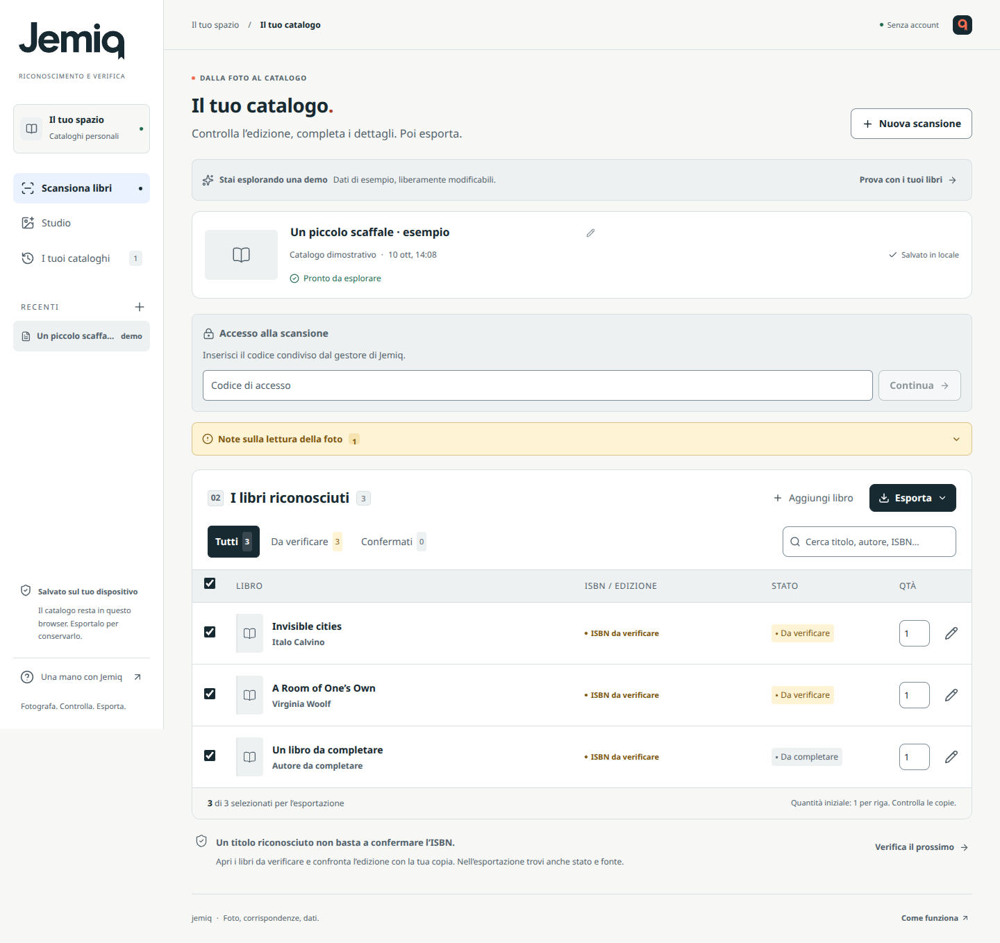

# Jemiq

**Fotografa i libri. Controlla i dati. Esporta il catalogo.**

Web app in italiano per trasformare una foto di uno scaffale o di un tavolo di libri in un elenco verificabile. Progettata per uso personale o per un piccolo gruppo di lavoro in libreria.

## Stato del progetto

Il repository originale, verificato il 10 ottobre 2026, conteneva soltanto il README di Google AI Studio e un unico commit su `main`. Questa è una nuova implementazione del flusso richiesto; non è stato possibile correggere sorgenti preesistenti perché non erano presenti.

Il flusso software è implementato e coperto da test automatici. **L’accuratezza del riconoscimento su foto reali non è ancora misurata**: occorrono una chiave Gemini attiva e un campione di libri con ISBN controllati sulla copia fisica. La demo è esplicita e marcata anche nei file esportati; non sostituisce mai una chiamata fallita.

## Funzioni

- Scatto tramite fotocamera del telefono o caricamento di una foto.
- Anteprima, rotazione e ricodifica locale in JPEG con lato lungo massimo 3200 px.
- Una chiamata Gemini per leggere le informazioni visibili, senza inventare i dati mancanti.
- Ricerca delle singole edizioni in Google Books e, quando necessario, Open Library.
- Risultati progressivi, annullamento, errori espliciti e conservazione delle righe già ricevute.
- Revisione dell’edizione, ricerca manuale, modifica dei dati e quantità esplicita.
- Segnalazione di possibili duplicati, senza accorparli né incrementare la quantità.
- Cronologia in IndexedDB, senza account e senza sincronizzazione fra dispositivi.
- Excel `.xlsx` e CSV con ISBN, titolo, autore, editore, pubblicazione, lingua, pagine, quantità, stato, fonte e note.

## La regola sugli ISBN

Un titolo riconosciuto non identifica automaticamente la sua edizione. Jemiq non prende il primo ISBN di una ricerca e non lo presenta come verificato.

| Stato | Significato | ISBN nell’export |
| --- | --- | --- |
| ISBN riscontrato | Codice letto nella foto, checksum valido, presente nel catalogo e coerente con gli altri dati osservati | Compilato |
| Confermato da te | Edizione scelta o dati confermati esplicitamente dall’utente | Compilato se presente e valido |
| Da verificare | Esistono edizioni candidate, ma la foto non prova quale sia quella corretta | Vuoto; proposta separata |
| Da completare | Dati poco leggibili, libro fuori catalogo o cataloghi indisponibili | Vuoto |

Anche “ISBN riscontrato” è un riscontro software, non una garanzia assoluta: il modello può leggere male una cifra e i cataloghi possono contenere errori. Per gli ordini controllare la copia fisica. Una copertina simile non è prova dell’edizione.

Titolo e autori leggibili devono trovare riscontro nella scheda. Contraddizioni su editore o lingua, oppure un ISBN associato esplicitamente a un ebook, richiedono revisione. I dati di un’edizione candidata non vengono copiati nel record osservato prima del riscontro o della conferma dell’utente; gli ISBN aggregati di un’opera Open Library non identificano una singola edizione.

Gli ISBN-10 sono verificati e convertiti a ISBN-13. XLSX salva l’ISBN come testo. Il CSV usa UTF-8 con BOM, separatore `;`, quoting e neutralizzazione delle formule; Excel può comunque scegliere una visualizzazione numerica in importazione, quindi XLSX è preferibile.

## Avvio locale

Occorre Node.js **22.12 o successivo**; sviluppo e verifica eseguiti con Node 24.

```bash
npm ci
cp .env.example .env
npm run dev
```

Apri `http://localhost:3000`. Inserisci `GEMINI_API_KEY` nel file `.env` per attivare il riconoscimento. Senza chiave restano disponibili interfaccia, demo, inserimento manuale, cronologia ed esportazione; le foto non vengono analizzate.

“Scatta una foto” dipende dal supporto del browser e su computer può aprire il selettore di file. È sempre disponibile “Carica foto”. HEIC/HEIF funziona solo nei browser che lo decodificano; altrimenti viene richiesto JPEG, PNG o WebP.

## Configurazione

Le chiavi restano sul server. **Non usare prefissi `VITE_` per i segreti e non inserirli nel codice o in GitHub.**

| Variabile | Uso |
| --- | --- |
| `GEMINI_API_KEY` | Chiave server per l’analisi delle fotografie |
| `GEMINI_MODEL` | Modello immagine + JSON strutturato; predefinito `gemini-3.8-flash`, modificabile senza build |
| `GOOGLE_BOOKS_API_KEY` | Chiave dedicata per identificare l’app e avere una quota Books; raccomandata per un servizio operativo |
| `JEMIQ_ACCESS_TOKEN` | Codice di accesso di almeno 16 caratteri, obbligatorio in produzione |
| `APP_ORIGIN` | Origine pubblica completa, per esempio `https://jemiq.example.com` |
| `PORT` | Porta del server, predefinita 3000 |
| `HOST` | `127.0.0.1` in locale; `0.0.0.0` per un container |
| `TRUST_PROXY` | Numero esatto di proxy fidati davanti all’app; 0 predefinito |

Il codice di accesso protegge l’uso del servizio a pagamento, si inserisce per sessione e non è la chiave Gemini. È una protezione per un piccolo gruppo, non un sistema di account. I cataloghi restano nel browser di ogni persona.

Google Books può limitare le chiamate senza chiave: in una verifica reale il 10 ottobre 2026 ha risposto 429 e il fallback Open Library ha risolto l’ISBN di prova. Per la produzione configurare una chiave Books e verificare le quote del proprio progetto.

## Build e produzione

```bash
npm run build
npm start
```

`npm start` imposta esplicitamente la produzione e serve frontend e API dallo stesso processo. Occorre un servizio Node o un container con HTTPS. **GitHub Pages da solo non è sufficiente**, perché il riconoscimento richiede un server che custodisca la chiave.

```bash
docker build -t jemiq .
docker run --rm -p 3000:3000 --env-file .env -e HOST=0.0.0.0 jemiq
```

Configurare le chiavi, `JEMIQ_ACCESS_TOKEN` e `APP_ORIGIN` nelle impostazioni del servizio di hosting. `.env` è escluso dall’immagine e il container viene eseguito come utente non root. Il Dockerfile è fornito come percorso di distribuzione; la sua build va verificata nell’ambiente Docker di destinazione.

In produzione, se il codice di accesso manca o è troppo corto, le API restano chiuse. `/api/health` indica soltanto disponibilità del riconoscimento e necessità del codice, senza esporre chiavi o dettagli dell’account.

### Avvio guidato su Render

**[Configura Jemiq su Render](https://render.com/deploy?repo=https%3A%2F%2Fgithub.com%2Femilioquattrini%2Fjemiq%2Ftree%2Fcodex%2Fjemiq-product)**

Il Blueprint [`render.yaml`](render.yaml) seleziona un servizio Node 24 a Francoforte sul piano Free per le prime prove. Chiede `GEMINI_API_KEY` e un `JEMIQ_ACCESS_TOKEN` di almeno 16 caratteri direttamente nel pannello Render; l'URL pubblico viene configurato automaticamente. Nessun segreto va aggiunto al file YAML.

Il link usa il ramo `codex/jemiq-product`. Gli aggiornamenti automatici sono disabilitati. Il piano Free si sospende dopo 15 minuti senza traffico e richiede circa un minuto per riattivarsi; è adatto al collaudo, mentre l'uso quotidiano richiede un servizio sempre attivo. L'API Gemini ha costi e quote separati.

**[Istruzioni complete e gestione dei segreti](docs/RENDER.md)**. Il servizio è stato creato e l'interfaccia aperta sul telefono. Dopo il fix del formato JSON è stato rimosso anche `candidateCount`, non supportato da Gemini 3.8. Distribuisci l'ultima correzione tramite **Manual Deploy → Deploy latest commit**, poi verifica con una scansione reale; i dettagli sono nel [protocollo di collaudo](docs/VALIDATION.md).

## Limiti operativi

- Una foto per catalogo; ogni scansione è un’unità di lavoro separata.
- Massimo 40 rilevamenti per foto con avviso al limite; non significa che siano stati individuati tutti i libri presenti.
- File locale fino a 32 MB, ricodifica fino a 4 MiB; il server rifiuta immagini oltre 8 MiB decodificati.
- Due scansioni simultanee per processo, una per IP; fino a tre arricchimenti bibliografici in parallelo.
- Timeout Gemini 60 secondi, singola richiesta ai cataloghi 8 secondi, scansione complessiva 165 secondi. L’attesa del limite Open Library precede il timeout della richiesta; ogni risposta bibliografica è limitata a 1 MiB. Nessun retry AI automatico che possa duplicare il costo.
- Cache di 200 risposte per 15 minuti; Open Library al massimo una richiesta al secondo per istanza.
- Dopo HTTP 429 o 503, pausa delle nuove richieste al solo catalogo interessato: 30 secondi predefiniti, oppure il valore valido di `Retry-After`, limitato a 60 secondi. Restano disponibili cache valida e altro catalogo. Nessun retry automatico; dopo la scadenza una nuova richiesta può riprovare.
- Se entrambi i cataloghi falliscono, la ricerca manuale restituisce un errore temporaneo esplicito; l’arricchimento conserva invece i dati osservati e le note sulle fonti indisponibili.
- Cache, pause dei provider e rate limit in memoria: per più istanze serve un limitatore condiviso. Questa versione è pensata per un processo singolo.
- Il riconoscimento richiede rete. La cronologia non è un backup: esportare prima di cancellare i dati del browser.
- Quantità iniziale 1 per riga rilevata; nessuna stima delle copie nascoste o della giacenza.

## Dati

La foto viene ricodificata dal browser, senza i metadati originali, poi inviata al server Jemiq e a Gemini. Jemiq non scrive immagini o risultati su disco nel server e non registra il contenuto delle richieste. La conservazione applicata dal provider dipende dall’account e dal piano Google; l’assenza di un archivio server Jemiq non implica la stessa politica del provider.

Titoli, autori e ISBN necessari alla ricerca vengono inviati ai cataloghi. Le copertine sono ammesse solo dai domini di Google Books e Open Library. Foto e cataloghi della cronologia sono memorizzati localmente in IndexedDB; la cancellazione dalla cronologia rimuove la copia locale, non i file già esportati.

## Verifiche

```bash
npm run typecheck
npm test
npm run build
npm audit --omit=dev
```

Test di checksum, conflitti di edizione/autore/editore/lingua/formato, fallback, limiti, JSON malformato, timeout, cancellazione, accesso, stream interrotti, export e persistenza. L’XLSX viene scritto e riaperto per verificare i tipi delle celle.

L’override di `uuid` a 11.1.1 risolve la dipendenza vulnerabile di ExcelJS conservando l’interfaccia CommonJS `v4`. L’esportazione è verificata con round trip del workbook. ExcelJS viene caricato solo quando si richiede XLSX.

Esito del collaudo software del 10 ottobre 2026: **152 test superati**, incluse le regressioni sul formato REST e sui parametri ammessi da Gemini 3.8, build di produzione riuscita e nessuna vulnerabilità nota nelle dipendenze di produzione. Verificati anche modifica, download e persistenza nel browser, con viewport desktop e mobile. Per dettagli e verifica sul campo: [protocollo di collaudo](docs/VALIDATION.md).

## Anteprima

Schermata reale della demo, con una delle edizioni confermata esplicitamente:



[Schermata iniziale](docs/screenshots/jemiq-home-desktop.png) · [Catalogo su mobile](docs/screenshots/jemiq-demo-mobile.png)

## Struttura

| Percorso | Responsabilità |
| --- | --- |
| `src/` | Interfaccia, immagini, persistenza ed export |
| `shared/` | Tipi, schemi e controlli ISBN |
| `server/vision.ts` | Lettura multimodale con schema e limiti |
| `server/catalog.ts` | Ricerca e riscontro delle singole edizioni |
| `server/app.ts` | API, streaming, accesso e limiti |
| `tests/` | Test senza chiavi o chiamate AI reali |

## Fonti tecniche

- [ISBN Agency: assegnazione ISBN](https://www.isbn-international.org/node/88)
- [Gemini: modelli](https://ai.google.dev/gemini-api/docs/models)
- [Gemini: immagini](https://ai.google.dev/gemini-api/docs/generate-content/image-understanding)
- [Gemini: output strutturati](https://ai.google.dev/gemini-api/docs/generate-content/structured-output)
- [Google Books: API](https://developers.google.com/books/docs/v1/using)
- [Open Library: opere ed edizioni](https://openlibrary.org/dev/docs/api/search)
- [Open Library: limiti](https://openlibrary.org/developers/api)
